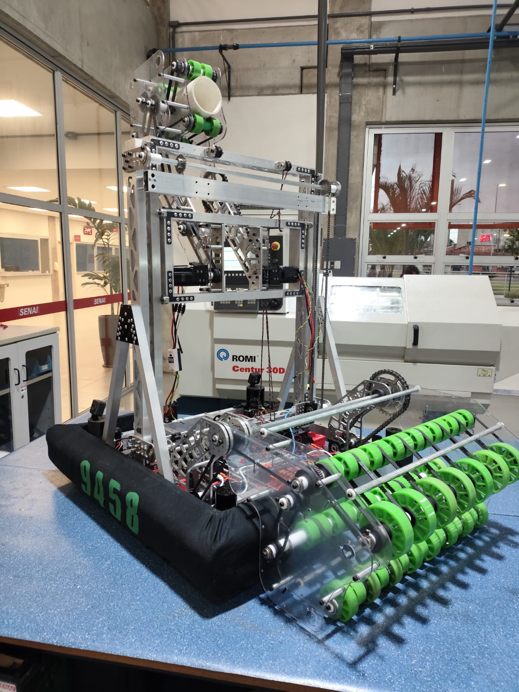
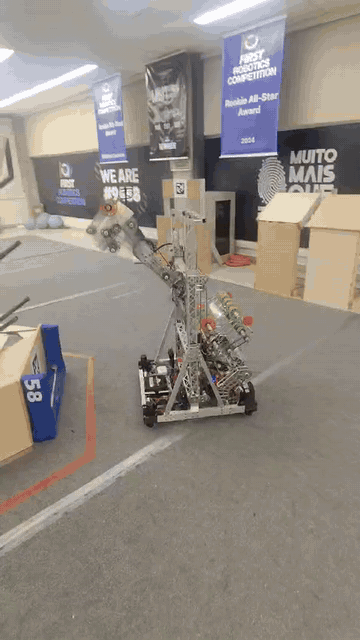
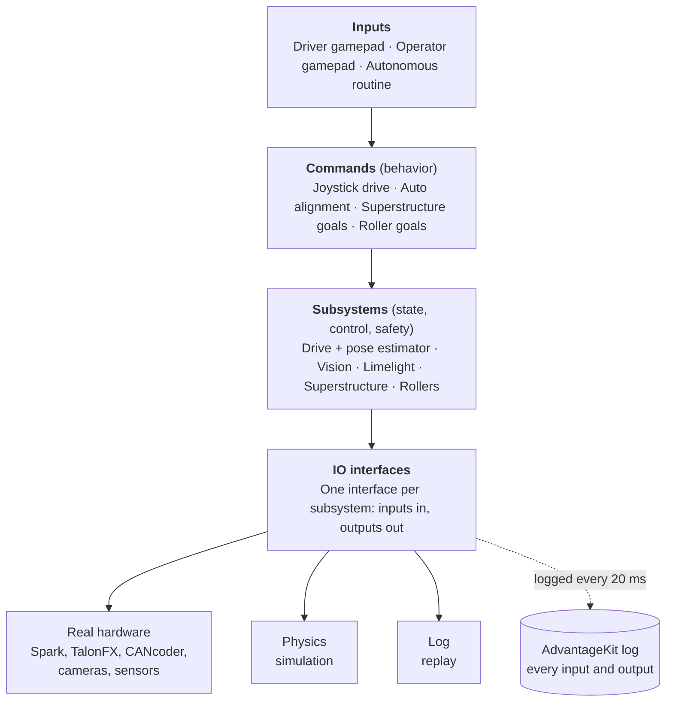
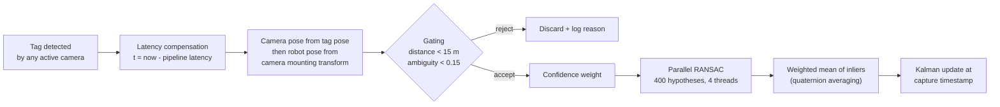

<div align="center">

# JACTECH 2025: Real-Time Control Software for a Competition Robot

**Sensor fusion, multi-camera localization, autonomous navigation and motion control for a 52 kg mobile manipulator, written in Java.**


*Snapshot of the code that ran on JACTECH's robot during the 2025 FRC season, published for reference.*

</div>

<table align="center">
  <tr>
    <td align="center"><br><sub>The robot: swerve drive base, elevator, pivoting arm and ground intake</sub></td>
    <td align="center"><br><sub>Elevator and arm placing a game piece on the scoring structure</sub></td>
  </tr>
</table>

---

## At a Glance

| | |
|---|---|
| **What it is** | The complete onboard software for a competition robot: driving, localization, autonomous navigation, and control of every mechanism. |
| **Where it runs** | A National Instruments roboRIO (embedded ARM controller) on a 20 ms real-time loop, talking to 15+ motor controllers and sensors over a CAN bus. |
| **Key engineering** | Multi-camera AprilTag localization with a custom parallel RANSAC outlier filter, latency-compensated Kalman sensor fusion, two-stage autonomous alignment, a state machine coordinating three motion-profiled mechanisms, and a hardware abstraction layer that lets the same code run on the robot, in a physics simulator, and as a deterministic replay of match logs. |
| **Scale** | About 9,600 lines of Java (excluding a vendor helper file), 37 IO interfaces and implementations, 9 simulation backends. |
| **Team** | FRC Team 9458, JACTECH, from Jacareí, São Paulo, Brazil. |
| **My role** | Tech Lead and Programmer. I led a group of three programmers. I set up the PhotonVision camera pipeline and the Limelight target selection, built the two-stage autonomous alignment and the autonomous routine, and set up the AdvantageKit logging and log replay we used to debug the robot. Other parts, including the pose estimator and RANSAC filter, were written by my teammates. |

---

## Table of Contents

1. [Background: What Is FRC?](#background-what-is-frc)
2. [The Engineering Problem](#the-engineering-problem)
3. [System Architecture](#system-architecture)
4. [Technical Deep Dives](#technical-deep-dives)
   - [Localization and Sensor Fusion](#1-localization-and-sensor-fusion)
   - [Autonomous Alignment](#2-autonomous-alignment)
   - [Mechanism Control and the Superstructure State Machine](#3-mechanism-control-and-the-superstructure-state-machine)
   - [Game Piece Detection](#4-game-piece-detection)
   - [Hardware Abstraction, Simulation and Log Replay](#5-hardware-abstraction-simulation-and-log-replay)
   - [Observability and Tuning](#6-observability-and-tuning)
5. [Hardware](#hardware)
6. [Tech Stack](#tech-stack)
7. [Repository Structure](#repository-structure)
8. [Getting Started](#getting-started)
9. [Design Decisions and Trade-offs](#design-decisions-and-trade-offs)
10. [Credits and License](#credits-and-license)

---

## Background: What Is FRC?

The **FIRST Robotics Competition (FRC)** is an international engineering competition for high school students. Every January a new game is announced, and each team has about eight weeks to design, build and program a robot of up to about 52 kg (115 lb, not counting battery and bumpers) that can play it. Teams work with professional engineers as mentors, and in the 2025 season more than 3,700 teams from around the world competed.

Matches are played by two alliances of three robots each on a field about 17.5 m by 8 m. Each match has two phases:

- **Autonomous (first 15 seconds):** robots run entirely on pre-written software, with no human input.
- **Teleoperated (remaining 2 minutes 15 seconds):** human drivers control the robots with gamepads, assisted by whatever automation the software provides.

### The 2025 game: REEFSCAPE

In 2025 the field featured a hexagonal structure called the **reef**. Robots collect PVC tubes called **coral** and place them on the reef's branches at four heights, **L1 (lowest) to L4 (highest)**. Robots can also remove and score playground balls called **algae**. Each of the reef's six faces has an **AprilTag** (a printed fiducial marker, similar to a QR code) whose exact field position is published, which makes vision-based localization possible.

---

## The Engineering Problem

From a software point of view, the robot is a **holonomic mobile manipulator operating under hard real-time and accuracy constraints**:

- **Placement precision.** Coral must land on a branch only a few centimeters wide, from a moving robot. Drivers cannot reliably do this by eye under match pressure, so the robot has to know where it is and align itself.
- **Noisy, delayed sensors.** Wheel odometry drifts as wheels slip during collisions. Camera pose estimates are accurate but arrive tens of milliseconds late and occasionally are badly wrong (ambiguous tag detections, reflections, motion blur).
- **Real-time loop.** All logic runs in a 20 ms control loop on an embedded ARM processor, alongside a 100 Hz odometry thread. Anything slow, blocking or memory-hungry hurts control quality.
- **Coordinated mechanisms.** The elevator, arm and intake share space. They must move in a defined order and stay within safe limits, or they collide with each other or the field.
- **Very little testing time on real hardware.** The robot is built in parallel with the code, so most software has to be developed and validated before the mechanism exists.

The architecture below is designed around those constraints.

---

## System Architecture

The project uses WPILib's **command-based** framework, where *subsystems* own hardware and *commands* describe behavior, with a cooperative scheduler running every 20 ms. On top of that, every subsystem talks to hardware only through an **IO interface**, which is the key to simulation and log replay.



---

## Technical Deep Dives

### 1. Localization and Sensor Fusion

The robot estimates its field pose (x, y, heading) by fusing two sources:

| Source | Strength | Weakness |
|---|---|---|
| **Wheel odometry + gyro** | Smooth, high rate (100 Hz), no latency | Drifts over time, breaks during wheel slip and collisions |
| **AprilTag vision** | Absolute, does not drift | Delayed, noisy, sometimes completely wrong |

**Odometry.** A dedicated thread (`SparkOdometryThread`) samples all eight swerve motor encoders and the Pigeon 2 gyro at **100 Hz**, independently of the 50 Hz main loop, and feeds the samples with their timestamps into WPILib's `SwerveDrivePoseEstimator` (a Kalman-style filter).

**Vision pipeline.** The code supports up to four PhotonVision cameras, one at each corner of the robot and each facing a different direction, for 360° tag coverage. The competition robot ran two of them on a single Orange Pi 5 Plus. Each control cycle, `VisionIOPhotonVision` processes every detected tag through this pipeline:



**Latency compensation.** A camera frame describes where the robot was when the image was captured, not where it is now. Each observation is stamped with `now - pipeline latency`. The drive subsystem keeps a 5-second history of past poses, used to evaluate each detection from where the robot actually was at capture time, and the pose estimator applies the measurement at that moment in the past and replays odometry forward, so delayed measurements do not drag the estimate backward.

**Confidence weighting.** Each single-tag estimate gets a weight that rewards unambiguous, close and head-on detections:

```math
w = \underbrace{\frac{1}{\max(\text{ambiguity},\ 0.01)}}_{\text{detection quality}} \cdot \underbrace{\frac{1}{1 + d}}_{\text{distance}} \cdot \underbrace{\left(1 + \left|\frac{t_x}{\lVert t \rVert}\right|\right)}_{\text{viewing angle}}
```

where `t` is the camera-to-tag translation. Estimates with a weight below 0.7 are dropped before outlier rejection.

**RANSAC outlier rejection (custom implementation, `PoseEstimator.java`).** With several cameras seeing several tags, a single bad detection can pull a simple average far off. The robot uses a consensus approach instead:

1. Pick a random candidate pose as the hypothesis.
2. Count how many other estimates agree with it, using a combined distance of translation error plus twice the rotation error (from the quaternion dot product). Estimates within 0.05 of the hypothesis are inliers.
3. Repeat **400 times**, split across a **4-thread pool** (100 iterations per thread), and keep the hypothesis with the most inliers.
4. Return the **weighted average of the inliers**. Rotations are averaged as quaternions, after flipping any quaternion in the opposite hemisphere so that `q` and `-q` (the same rotation) do not cancel out.

The winning pose goes into the Kalman filter with standard deviations of 0.1 m, 0.1 m and 0.1 rad. Every intermediate value (inlier ratio, outliers, distance from odometry) is logged so the filter can be tuned from real match data.

The repository also contains a **Levenberg-Marquardt pose refiner** (`PoseRefiner.java`) that minimizes the weighted 6-DoF residual over the inlier set with a numerically computed Jacobian. It is written and compiles, but it is not currently enabled in the pipeline.

### 2. Autonomous Alignment

Placing coral by hand is slow and inconsistent, so the driver can press a single trigger to have the robot drive itself to the left or right branch of the nearest reef face.

1. **Target selection.** A front-mounted Limelight camera reports the ID of the AprilTag it sees. A lookup table maps each of the 12 reef tag IDs (6 per alliance) to the scoring pose in front of that face, defined in field coordinates and mirrored automatically for the red alliance (`AllianceFlipUtil`).
2. **Branch offset.** The left and right branch poses are computed by shifting the face pose 0.18 m perpendicular to its heading:

   ```math
   p_{\text{left}} = p + 0.18 \cdot (-\sin\theta,\ \cos\theta) \qquad p_{\text{right}} = p - 0.18 \cdot (-\sin\theta,\ \cos\theta)
   ```

3. **Stage 1, coarse approach (`PathFindToPose`).** PathPlanner's AD* (Anytime Dynamic A\*) pathfinder plans a collision-free path around field obstacles on the fly and follows it at reduced speed.
4. **Stage 2, precise alignment (`DriveToPose`).** A holonomic controller with two translation PID loops and a motion-profiled rotation PID loop drives the robot onto the exact branch pose. A minimum output speed prevents the robot from stalling just short of the target due to static friction. The command only finishes when the robot is within **5 cm and 3°** of the target **and** its linear and angular speeds have dropped below set thresholds, so the next action starts from a settled position.

The same `AutoAlignment` command is reused by the autonomous routine, so teleop and autonomous share one tested code path.

### 3. Mechanism Control and the Superstructure State Machine

The robot has three positioned mechanisms:

| Mechanism | Actuators | Feedback | Control |
|---|---|---|---|
| **Elevator** | 2 NEO motors (leader and inverted follower) on Spark MAX | Motor encoder | REV MAXMotion trapezoidal profile on the motor controller, plus a WPILib trapezoidal profile and elevator feedforward |
| **Arm (outtake pivot)** | Kraken motor on TalonFX | CANcoder absolute encoder (fused as remote sensor) | CTRE Motion Magic (jerk-limited profile), arm feedforward with gravity compensation, soft limits from -50° to 155° |
| **Intake pivot** | 2 Kraken motors (leader and follower) | CANcoder absolute encoder | Motion Magic, soft limits from -110° to 0° |

Instead of letting commands move each mechanism independently, a single **`Superstructure`** class owns all three and exposes named **goals**. Each goal maps to a coordinated set of setpoints:

| Goal | Elevator | Arm | Purpose |
|---|---|---|---|
| `STOW` | down | stowed (150°) | Safe travel position, default whenever no button is held |
| `GROUND_INTAKE` | down | stowed | Pick coral up from the floor (intake deploys) |
| `L1`, `L2`, `L3` | level-specific height | scoring angle (-45°) | Score coral on each reef level |
| `UP_ALGAE`, `DOWN_ALGAE` | algae height | algae angle | Knock algae off the reef |
| `REMOVE_CORAL` | high | stowed | Clear a jammed coral |

Design properties:

- **Single source of truth.** Commands request a goal, and the superstructure decides the setpoints. Two buttons pressed at once cannot command conflicting mechanism positions.
- **Fail-safe default.** Every goal command reverts to `STOW` when released, and the superstructure forces `STOW` whenever the robot is disabled.
- **Profiles everywhere.** All motion uses trapezoidal or jerk-limited profiles, which reduces mechanical stress, current spikes and game piece ejection.
- **Health monitoring.** Disconnected motors or absolute encoders raise dashboard alerts in real time.

### 4. Game Piece Detection

A **CTRE CANrange time-of-flight sensor** at the outtake measures the distance to the game piece. When coral is closer than 10 cm, the `Rollers` subsystem marks it as staged and automatically stops all intake rollers, so a driver holding the intake button cannot over-feed or jam the mechanism. The sensor's field of view and proximity hysteresis are configured in code.

### 5. Hardware Abstraction, Simulation and Log Replay

Every subsystem is split into a hardware-agnostic logic class and an **IO interface** with interchangeable implementations:

```
Elevator  (logic: profiles, goals, safety)
   └── ElevatorIO        (interface: inputs + outputs)
         ├── ElevatorIONeo   (real Spark MAX hardware)
         ├── ElevatorIOSim   (physics model)
         └── (empty)         (log replay)
```

At startup, `RobotContainer` picks the implementation based on the run mode:

| Mode | Hardware | Purpose |
|---|---|---|
| `REAL` | Physical robot | Competition and testing |
| `SIM` | Physics models for drive, mechanisms and all four supported cameras | Develop and test without a robot |
| `REPLAY` | None; inputs are read back from a match log | Re-run the exact code on recorded data, deterministically |

**Why this matters.** The vision simulation renders the real AprilTag layout as seen from each simulated camera (1280x720, 60 FPS, 50 ms latency), so the entire localization and alignment stack can run on a laptop. With **log replay**, a bug seen in a real match can be reproduced exactly, debugged, and verified fixed against the same recorded inputs before the robot is touched again.

### 6. Observability and Tuning

- **Full-state logging (AdvantageKit).** Every IO input and key output is logged each cycle to a WPILOG file on the robot and streamed live over NetworkTables. Each log also records the build date, git commit hash, branch and whether there were uncommitted changes, so any log can be matched to the exact code that produced it.
- **Motor controller telemetry (URCL).** Raw REV motor controller data is captured in the same log.
- **Live tuning.** PID gains, feedforward constants, motion profile limits and setpoints are `LoggedTunableNumber`s that can be changed from the dashboard while the robot runs, then copied back into code.
- **Visualization.** Mechanism setpoints, goals and measured positions are published as 2D mechanism models, and poses, paths and RANSAC outliers are published for AdvantageScope's 3D field view.

---

## Hardware

| Component | Details |
|---|---|
| Controller | NI roboRIO (embedded real-time Linux, ARM) |
| Drive | 4 REV MAXSwerve modules: NEO Vortex drive motors on Spark Flex, NEO 550 steering motors on Spark MAX, through-bore absolute encoders, 5.08:1 drive reduction, 1.5 in wheels |
| Gyro | CTRE Pigeon 2 (IMU) |
| Elevator | 2 NEO motors on Spark MAX |
| Arm and intake pivots | 3 Kraken motors on TalonFX, 2 CANcoder absolute encoders |
| Rollers | NEO motors on Spark MAX (intake, indexer, outtake) |
| Sensors | CTRE CANrange time-of-flight sensor |
| Vision | 2 PhotonVision cameras on an Orange Pi 5 Plus coprocessor (the code supports up to 4), 1 Limelight |
| Robot mass | About 52 kg |

---

## Tech Stack

| Technology | Version | What it is used for |
|---|---|---|
| Java | 17 | Language for all robot code |
| WPILib (GradleRIO) | 2025.2.1 | Robot framework: command scheduler, kinematics, Kalman pose estimator, profiles, simulation |
| AdvantageKit | 4.1.0 | Deterministic logging and log replay |
| PathPlannerLib | 2025.2.2 | On-the-fly AD* pathfinding and holonomic path following |
| ChoreoLib | 2025.0.2 | Autonomous routine framework (time-optimal trajectories planned for future routines) |
| PhotonLib | 2025.1.1 | AprilTag detection on the PhotonVision cameras and camera simulation |
| Limelight helpers | 2025 | Front camera target data |
| CTRE Phoenix 6 | 25.2.1 | TalonFX, CANcoder, Pigeon 2 and CANrange drivers, Motion Magic |
| REVLib | 2025.0.2 | Spark MAX and Spark Flex drivers, MAXMotion |
| URCL | 2025.0.1 | REV motor controller logging |
| Apache Commons Math | 3.6.1 | Matrix algebra for the Levenberg-Marquardt refiner |
| Lombok | 1.18.36 | Boilerplate reduction (getters, setters) |
| Spotless + google-java-format | 6.12.0 | Consistent code formatting |
| GitHub Actions | | Builds the project on every push |

---

## Repository Structure

```
src/main/java/frc/robot/
├── Robot.java                    # Entry point, logging setup, run mode selection
├── RobotContainer.java           # Wires subsystems, IO implementations, controls, autos
├── Constants.java                # Run mode (REAL / SIM / REPLAY), loop period
├── commands/
│   ├── AutoAlignment.java        # Two-stage alignment: pathfind, then precise PID
│   ├── PathFindToPose.java       # AD* pathfinding to a target pose
│   ├── DriveToPose.java          # Holonomic PID controller to an exact pose
│   ├── AutoRoutineBuilder.java   # Autonomous routines
│   └── DriveCommands.java        # Teleop driving and characterization routines
├── subsystems/
│   ├── drive/                    # Swerve drive, odometry thread, pose estimator, sim
│   ├── vision/
│   │   ├── VisionIOPhotonVision.java  # Multi-camera pipeline (up to 4), gating, weighting
│   │   ├── PoseEstimator.java         # Parallel RANSAC and quaternion averaging
│   │   ├── PoseRefiner.java           # Levenberg-Marquardt refinement (not yet enabled)
│   │   ├── VisionLimelight.java       # Target face selection, branch offsets
│   │   └── VisionIOSim.java           # Simulated cameras
│   ├── superstructure/
│   │   ├── Superstructure.java   # Goal state machine
│   │   ├── Elevator/             # Elevator logic, IO, sim, visualizer
│   │   ├── Outtake/              # Arm logic, IO, sim, visualizer
│   │   └── Intake/               # Intake pivot logic, IO, sim, visualizer
│   └── rollers/                  # Roller state machine and game piece sensor
├── constants/                    # Shared control loop gains
└── util/                         # Field geometry, alliance flipping, PID helpers, alerts, tunables

src/main/deploy/
├── 2025-reefscape.json           # AprilTag positions on the field
├── pathplanner/                  # Pathfinding navigation grid and settings
└── choreo/                       # Choreo project and trajectories
```

---

## Getting Started

### Prerequisites

- [WPILib 2025](https://docs.wpilib.org/en/stable/docs/zero-to-robot/step-2/wpilib-setup.html), which bundles JDK 17 and a configured VS Code
- [AdvantageScope](https://github.com/Mechanical-Advantage/AdvantageScope) to visualize simulation and logs (included with WPILib)

No robot is needed to build or simulate the project.

### Build and simulate

```bash
git clone https://github.com/RafaelOliveira5501/jactech-2025-public.git
cd jactech-2025-public

# Compile (Spotless auto-formats the code first)
./gradlew build

# Run the full robot in physics simulation
./gradlew simulateJava
```

Then open AdvantageScope, connect to the simulator, and open the 3D field view to see the robot, its estimated pose and the camera observations.

### Replay a match log

Set `simMode` to `Mode.REPLAY` in `Constants.java`, run `./gradlew simulateJava`, and select a `.wpilog` file. The code re-runs on the recorded inputs and writes a new log with a `_sim` suffix for comparison.

### Deploy to a robot

```bash
./gradlew deploy   # requires a connection to the robot's network
```

<details>
<summary><b>Driver and operator controls</b></summary>

**Driver (gamepad, port 0)**

| Input | Action |
|---|---|
| Left stick | Translate (field-relative) |
| Right stick | Rotate |
| Right bumper | Cycle speed level (10%, 25%, 50%, 75%, 100%) |
| X (hold) | Hold heading at 0° while driving |
| A (hold) | Lock wheels in an X pattern to resist being pushed |
| B | Reset gyro heading |
| Left bumper (hold) | Ground intake |
| Left trigger | Auto-align to left branch of the nearest reef face |
| Right trigger | Auto-align to right branch of the nearest reef face |

**Operator (gamepad, port 1)**

| Input | Action |
|---|---|
| A / X / B | Score on L1 / L2 / L3 |
| Left bumper / Right bumper | Remove low / high algae |
| Right stick press | Clear a jammed coral |
| Left trigger | Run rollers inward |
| Right trigger | Run rollers outward |
| Y | Lower elevator |

</details>

---

## Design Decisions and Trade-offs

**Custom RANSAC instead of trusting each camera.** The simplest approach feeds every camera estimate straight into the Kalman filter. That works until one camera sees an ambiguous tag and reports a pose a meter away, which yanks the estimate and can send an alignment command the wrong way. A consensus filter rejects that kind of outlier, at the cost of CPU time on the roboRIO. Splitting the 400 iterations across a thread pool keeps it within the loop budget.

**PhotonVision cameras plus one Limelight.** The PhotonVision cameras maximize the number of visible tags for global localization. The Limelight is used only to answer one question, which reef face the robot is looking at, so target selection does not depend on the full global pose being perfect.

**Two-stage alignment.** A path planner is good at getting around obstacles but not at the last few centimeters, and a PID controller is precise but has no notion of obstacles. Combining them gets both, and the strict finish condition (position, heading and velocity) makes the behavior predictable for the operator.

**Goal-based state machine instead of independent mechanism commands.** Independent commands are quicker to write, but they make it possible to command a collision. Centralizing coordination in one class is slightly more code, but it makes the robot's state explicit, loggable and safe by default.

**Simulation and replay from day one.** The IO pattern adds an interface and a sim class per subsystem. In return, software development is not blocked on the mechanical build, and real match failures can be debugged offline.

---

## Credits and License

Built by the programming team of **FRC 9458 JACTECH** (Jacareí, São Paulo, Brazil).

This project builds on open-source work from the FRC community, and keeps the original copyright headers in the adapted files:

- **[Mechanical Advantage, FRC 6328](https://github.com/Mechanical-Advantage):** the AdvantageKit swerve drive template, the roller framework, field constants and several utilities (GPL v3).
- **[Iron Maple, FRC 5516](https://github.com/Shenzhen-Robotics-Alliance):** PID controller and interpolation utilities used by the alignment controllers.
- **WPILib**, **AdvantageKit**, **PathPlanner**, **Choreo**, **PhotonVision**, **Limelight**, **CTRE Phoenix 6** and **REVLib**.

Because parts of this project are derived from GPL v3 code, this project is licensed under the GPL v3 (see `LICENSE`). See `AdvantageKit-License.md` and `WPILib-License.md` for the third-party license texts.
